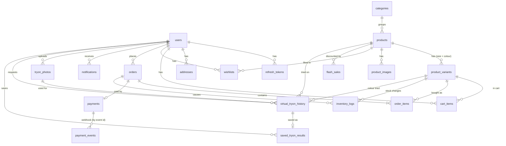

# ER Diagram and Normalization

## Diagram (Mermaid)

`payment_events` stores only the Razorpay event id, so it is linked by value, not by a foreign key.

## Relationships in simple words

| Relationship | Type | Where it lives |
|---|---|---|
| category -> products | one-to-many | `products.category_id` |
| product -> variants | one-to-many | `product_variants.product_id` |
| user <-> product (wishlist) | many-to-many | `wishlists` (composite primary key) |
| order <-> product variant | many-to-many | `order_items` |
| user -> orders | one-to-many | `orders.user_id` |
| order -> payment | one-to-one | `payments.order_id UNIQUE` |
| photo -> try-on previews | one-to-many | `virtual_tryon_history.photo_id` |

## Normalization

**1NF** - every column holds one simple value. A size and a colour are separate columns, a product's pictures are rows in `product_images` and not a list in a cell.

**2NF** - every non-key column depends on the whole key. `wishlists` and `order_items` could have composite keys; their extra columns describe the whole row. Stock depends on the *variant* (size + colour), so it lives in `product_variants`, not in `products`.

**3NF** - no column depends on another non-key column. The category name is stored once in `categories` (products only keep `category_id`). The customer's name and email are stored once in `users`. Uploaded photo paths are stored once in `tryon_photos` and referenced by many previews.

**Deliberate copies (denormalization).** `order_items` copies `product_name`, `size`, `color` and `unit_price`, and `orders.shipping_address` copies the address text. This is intentional: an old order must keep showing what the customer really bought and the price they really paid, even if the product is renamed, the price changes, or the address is deleted.

## Constraints used

- `PRIMARY KEY`, `FOREIGN KEY` (with `ON DELETE CASCADE` for owned data such as cart items, `SET NULL` for history)
- `UNIQUE`: email, `(user_id, variant_id)` in the cart, `(product_id, size, color)` for variants, `(user_id, idempotency_key)` for orders, `razorpay_order_id`
- `CHECK`: `stock_quantity >= 0`, `quantity > 0`, `base_price >= 0`, allowed status lists, `ends_at > starts_at`, `consent_given` must be true
- `NOT NULL` on required columns, `NUMERIC(10,2)` for money (no floating-point rounding errors)

## Indexes

Primary keys and `UNIQUE` columns get an index automatically. Extra indexes (see the end of `schema.sql`) are on the columns used in `WHERE`, `JOIN` and `ORDER BY`: `products(category_id)`, `product_variants(product_id)`, `cart_items(user_id)`, `orders(user_id, created_at DESC)`, `order_items(order_id)`, `inventory_logs(variant_id)`, `flash_sales(product_id, starts_at, ends_at)`, and a **partial index** `orders(reservation_expires_at) WHERE status = 'PENDING_PAYMENT'` so the expiry job only scans unpaid orders.

Product name search uses `ILIKE '%text%'`, which a normal B-tree index cannot speed up. For a large catalogue you would add the `pg_trgm` extension and a trigram index. This is noted as a limitation.
